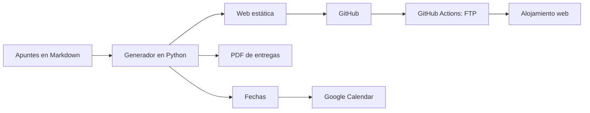
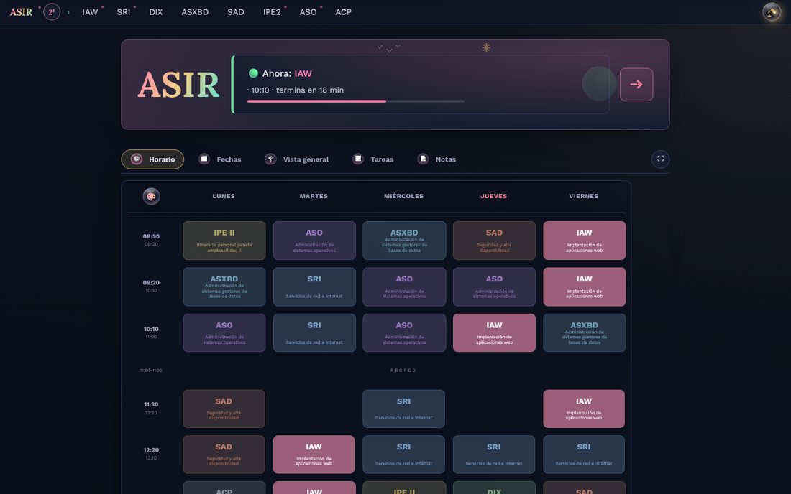
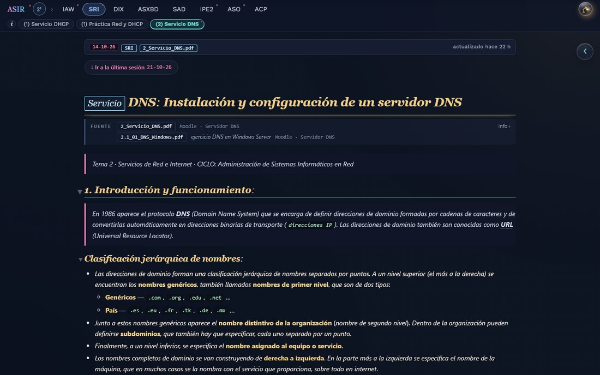
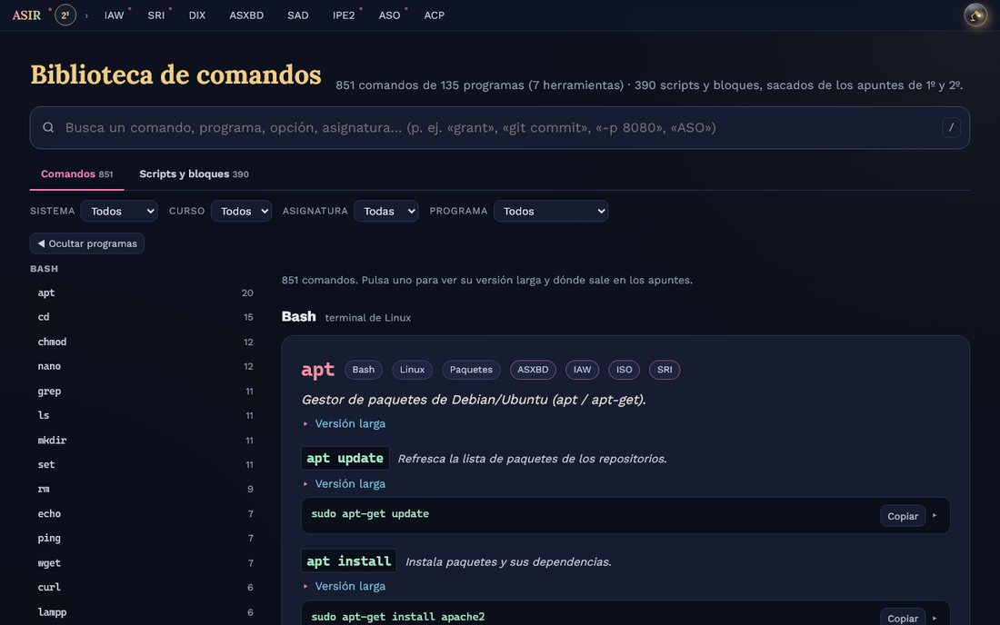

# Proyectos con ayuda de IA

Proyectos propios hechos con un **asistente de IA para programar** (Claude Code), en curso o terminados. Yo decido qué se construye, fijo las normas y **reviso y pruebo** cada cambio. La IA escribe buena parte del código y de los scripts. Aquí van descritos. El código de cada uno se irá publicando cuando esté limpio.

## 1. Web de apuntes de ASIR

**[daniroca5.gamer.gd](https://daniroca5.gamer.gd/)**. Mis apuntes del ciclo, en Markdown, se convierten en una **web estática** que se publica sola.

- **Generador en Python**: lee el *vault* de apuntes (convención de nombres por asignatura, tema y tipo) y crea las páginas, el menú y el índice lateral.
- **Inicio con panel**: clase en curso, horario, fechas de exámenes y entregas, **tablero de tareas** sacado de las casillas de los apuntes, y notas.
- **Buscador** (Ctrl+K), **biblioteca de comandos** enlazada desde los bloques de código, resaltado de sintaxis, 5 temas de color y modo de accesibilidad.
- **Sincronización** de lo marcado entre dispositivos con una pequeña API en PHP.
- **Publicación automática**:
  - el código va a GitHub y una **GitHub Action** lo sube por FTP al alojamiento;
  - las fechas de exámenes pasan a **Google Calendar** con avisos en el móvil;
  - las entregas salen en **PDF** desde el mismo Markdown.

## 2. La tele con IA

Control de la **Android TV** de casa desde el PC por **ADB**, en la red local:
- averiguar **por qué capítulo voy** de una serie leyendo la pantalla de la app;
- dejar listo el siguiente para reproducirlo cuando yo diga;
- abrir películas de mi colección con un reproductor de vídeo.

Es un ejercicio de automatización sobre un dispositivo «cerrado»: entradas de teclado, capturas de pantalla y lectura de la interfaz.

## 3. Ordenar el PC

Proyecto por tandas para poner orden en años de archivos:
- **indexar** los discos;
- proponer **movimientos y renombrados** con una convención fija (vídeos, imágenes, música, documentos…);
- detectar **duplicados verificados por contenido**, nunca solo por nombre;
- generar **informes y buscadores en HTML**.

Nada se borra sin revisarlo conmigo: el 95 % es mover y renombrar.

## 4. Scripts de descarga y catalogación

Scripts que **recopilan el contenido que tengo guardado en distintas plataformas** y lo descargan a local con sus datos (título, fecha, origen, etiquetas). Así queda organizado por categorías y se puede consultar en local. Trabajo con APIs y exportaciones, reintentos, registro de lo ya descargado y ejecución en segundo plano con progreso visible.

## 5. Otros

- **Mensajería entre mis PCs**: una pequeña aplicación de escritorio en C# que manda avisos y órdenes entre ordenadores por una **red privada (Tailscale)**, con tarjetas en pantalla.
- **Material de clase**: descarga del material del aula virtual a carpetas por asignatura y paso de las fechas de entrega al calendario.

## Cómo trabajo con IA

- **Normas escritas**: convenciones de nombres, de formato y de seguridad guardadas como instrucciones que la IA sigue en cada sesión.
- **Todo en Git**: cada cambio queda en un commit con su mensaje, y lo que no funciona se revierte.
- **Verificar antes de dar algo por hecho**: capturas, pruebas en el navegador o en el móvil y validación automática antes de publicar.
- **Privacidad**: lo personal se queda en local y nunca va a un repositorio público.

---

Daniel Roca Martínez · [Currículum](https://daniroca5.gamer.gd/cv/) · [LinkedIn](https://www.linkedin.com/in/daniel-r-m-02b369164/)
