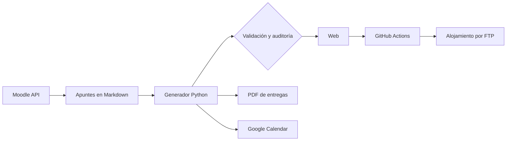
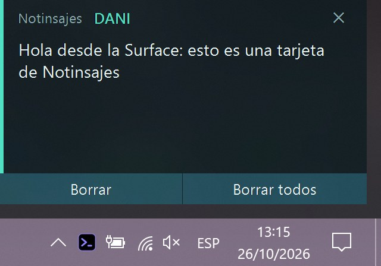
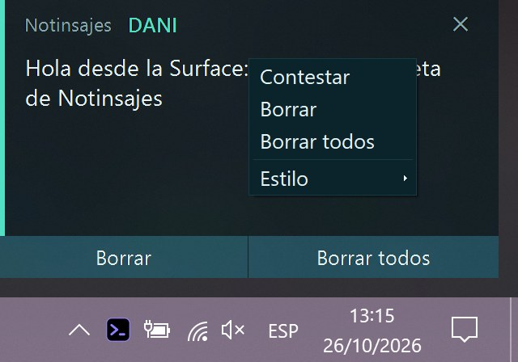
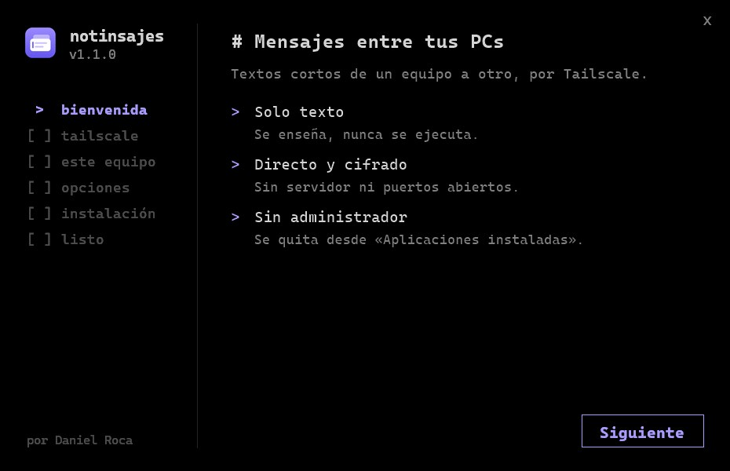
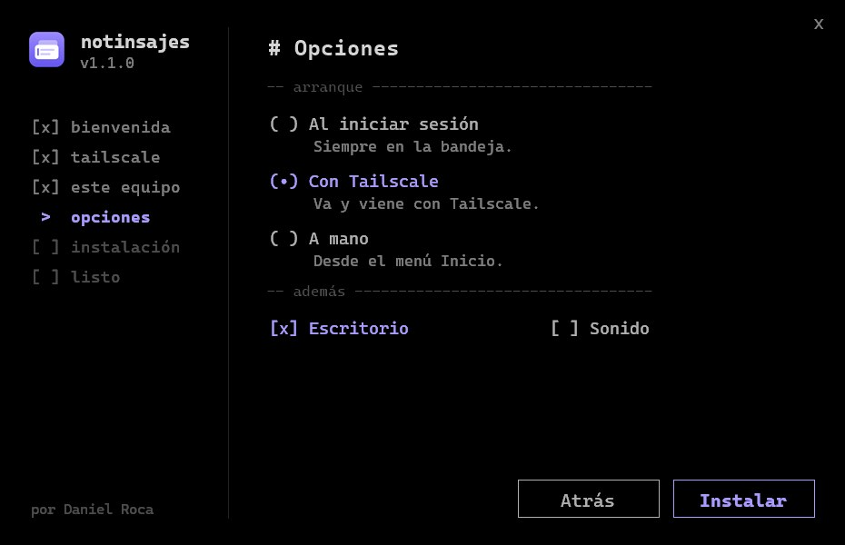
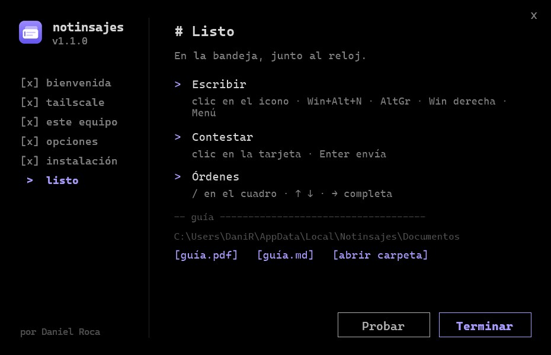

# Proyectos con ayuda de IA

Proyectos propios hechos con un **asistente de IA para programar** (Claude Code). El reparto es este:
- **yo** decido qué se construye, fijo las normas y **reviso y pruebo** cada cambio en el navegador, el móvil o el PC;
- **la IA** escribe buena parte del código y de los scripts.

Todo queda en Git.

## 1. Web de apuntes de ASIR

**[daniroca5.gamer.gd](https://daniroca5.gamer.gd/)**. Escribo los apuntes del ciclo en Markdown y un **generador en Python** los convierte en una web estática que se publica sola. La uso a diario en clase y para estudiar desde el móvil.

 

### Cómo se crean las páginas

- Cada documento es un `.md` con un nombre que dice **asignatura, trimestre, tema, título y tipo**, por ejemplo `SRI[1](2)__DNS__[T].md` (`T` teoría, `P` práctica, `T-P` mixto, `C` cuestionario). El generador lo coloca solo en el menú de su asignatura y en su carpeta.
- Dentro del texto, unas marcas sencillas activan funciones de la web:
  - `[x]` / `[ ]` en un paso lo convierte en **tarea con casilla**;
  - `!!! [(fechas)] Examen (30-10-26):` crea una **fecha** de examen o entrega;
  - `| [[dd-mm-aa]] |` marca una **sesión de clase**, y una bandera indica hasta dónde se llegó;
  - las etiquetas silenciosas agrupan contenidos relacionados.
- Las capturas se recortan solas a partir de unos recuadros guardados, y la misma imagen sirve para la web y para el PDF.

### Cómo se publica

Un solo comando hace todo el ciclo:
1. **Bajar** los últimos cambios de Git.
2. **Generar** la web completa (dos cursos, más de 90 páginas).
3. **Validar**: enlaces rotos, imágenes que faltan y notas mal escritas. Una **auditoría** revisa además que tareas y fechas no estén repetidas ni a medias.
4. **Commit y push**. Una **GitHub Action** la despliega por FTP al alojamiento en un par de minutos.
5. **Calendario**: compara las fechas de la web con Google Calendar y crea, cambia o borra los eventos, con avisos en el móvil.

### Qué se puede hacer en la web

- **Inicio**: la clase en curso y la siguiente con cuenta atrás, el horario, las **fechas** (en lista o en calendario, con los exámenes en rojo), una **vista general** en árbol y un **tablero de tareas** (pendientes y completadas, por grupos) sacado de las casillas de los apuntes.
- **Índice lateral (TOC)** en cada documento, de H1 a H4:
  - va fijo al hacer scroll y marca la sección en la que estás;
  - tiene botones para **ir a la última sesión** de clase o a un **marcador** propio;
  - muestra las etiquetas y tareas del documento y los documentos relacionados.
- **Página de comandos**: una biblioteca con todos los comandos que aparecen en los apuntes (Linux, Windows, PowerShell, MySQL…), filtrables por sistema, programa y asignatura y con su explicación. Cada bloque de código de los apuntes **enlaza** a su comando.
- **Bloques de código**: resaltado como en el editor, botón de copiar (solo el comando, sin el prompt) y notas numeradas.
- **Buscador** (Ctrl+K) en todo el sitio, con glosario de siglas: al pasar el ratón sale su definición.
- **Tests interactivos** para repasar, y **visor de capturas** con zoom y flechas.
- **Pestaña Material**: los ficheros del aula virtual de cada asignatura, por tema.
- **5 temas de color**, tamaño de interfaz y **modo de accesibilidad**.
- **Sincronización** entre dispositivos (tareas hechas, casillas, marcadores) con una pequeña **API en PHP**.

### Integraciones

- **Moodle (API de servicios web)**: un script en Python se conecta al aula virtual del centro con un **token** personal, guardado en el gestor de credenciales de Windows y nunca en el código. Con él:
  - ve qué material es nuevo o ha cambiado y lo **descarga** a la carpeta de cada asignatura, sin duplicar lo que ya tengo;
  - lee las **fechas de entrega** para pasarlas al calendario;
  - escribe un **registro** que la web muestra en la pestaña *Material*.
- **Google Calendar**: exámenes y entregas con avisos días antes.
- **PDF de entregas**: la misma fuente Markdown genera un PDF con portada, índice navegable, capturas enmarcadas y los metadatos correctos (autor, título, palabras clave), y una copia en Word.

## 2. La tele con IA

Control de la **Android TV** de casa desde el PC por **ADB**, en la red local. El asistente:
- abre la aplicación;
- busca la serie y **lee en pantalla por qué capítulo voy**;
- deja preparado el siguiente, esperando a que yo diga «sí» para reproducirlo.

También abre películas de mi colección con un reproductor de vídeo. Es automatización sobre un dispositivo «cerrado»: entradas de mando, capturas de pantalla y lectura de la interfaz.

## 3. Ordenar el PC

Proyecto por tandas para poner orden en años de archivos repartidos por varios discos:
- **indexar** todo y proponer **movimientos y renombrados** con una convención fija (vídeos, imágenes, música, documentos…);
- detectar **duplicados verificados por contenido** (hash), nunca solo por nombre;
- dejar **informes y buscadores en HTML** para encontrar cualquier cosa.

Nada se borra sin revisarlo conmigo: el 95 % es mover y renombrar.

## 4. Scripts de descarga y catalogación

Scripts que recopilan el contenido que tengo guardado en distintas plataformas y lo **descargan a local con sus datos** (título, fecha, origen, etiquetas), organizado por categorías. Tienen **reintentos**, un **registro de lo ya descargado** para no repetir, ejecución en segundo plano y una ventana con el progreso.

## 5. Notinsajes: mensajería entre mis PC

**Notinsajes** es una aplicación de escritorio para Windows, hecha en **C#**, que manda mensajes de texto cortos de un ordenador mío a otro. El mensaje aparece como una **tarjeta** abajo a la derecha de la pantalla, junto al reloj, y se puede contestar desde ella. La uso entre mi PC de sobremesa, mi portátil (Surface) y el portátil de un familiar.

 

### Cómo funciona

1. **Enviar**: el mensaje se guarda como un pequeño `.json` (`{v, de, texto, fecha}`) en una cola y se manda con **Taildrop**, la función de Tailscale para pasar archivos entre equipos de la misma cuenta. Si el otro PC está apagado, el mensaje espera en la cola y se **reintenta cada 30 s** en un hilo aparte.
2. **Recibir**: un servicio sin ventana, con un icono en la bandeja, mira cada 2 s la carpeta donde Taildrop deja los archivos. Solo acepta `tsmsg_*` y `tsack_*` de **equipos conocidos**, con el remitente coincidiendo con el nombre del archivo, de **menos de 64 KB** y con JSON válido. Lo demás se descarta.
3. **Acuse de recibo**: al llegar un mensaje, el receptor devuelve un acuse. Así, desde un solo PC compruebo que el otro lo ha recibido y lo está enseñando, y que los dos sentidos funcionan.
4. **Contestar**: un clic en la tarjeta abre un cuadro de texto; Enter envía y Mayús+Enter salta de línea. La respuesta va a quien escribió el mensaje y quita la tarjeta original.

### Por qué es seguro

- **Lo recibido nunca se ejecuta**: solo se lee como JSON y se enseña como texto.
- **Sin servidor y sin puertos abiertos**: los mensajes viajan **cifrados punto a punto** por Tailscale (WireGuard), sin pasar por ningún servidor de terceros.
- **Solo equipos de mi cuenta**: Taildrop no acepta archivos de otras cuentas, y además el programa descarta lo que no venga de un equipo de su tabla.
- **Sin administrador**: todo se instala en el perfil del usuario (`HKCU`, `%LOCALAPPDATA%`), sin tocar el sistema.
- **Las órdenes solo se aceptan en local**: desde fuera solo llegan mensajes, acuses y peticiones de borrar tarjetas del mismo equipo.

### Qué hace

- **Tarjetas** con 5 temas de color (los mismos que la web) y un estilo alternativo que imita la notificación de Windows. Se apilan si llegan muchas.
- **Cuadro de órdenes**: al escribir `/` salen sugerencias como en PowerShell (↑ ↓ para elegir, Tab o → para completar). Por ejemplo `/con` cambia el destino, `/estado` enseña la cola y el último acuse, `/tema` cambia el aspecto, `/retirar` borra lo que envié y `/demo` manda mensajes de prueba para ver cómo se apilan.
- **Atajos de teclado**: un gesto de **tres teclas** en el que el orden decide la acción (contestar, borrar todas, retirar lo enviado), con un gancho de teclado de bajo nivel que solo mira esas teclas. Hay otro atajo del sistema de reserva para cuando delante hay una ventana de administrador.
- **Consola**: `--enviar`, `--estado` y `--orden` permiten usarlo desde scripts. Mi asistente de IA lo usa así para avisarme entre equipos.
- **Instalador propio**: el mismo `.exe` abre un asistente con estética de consola (negro, monoespaciado y con poco texto) que comprueba Tailscale, detecta el equipo, pregunta cómo arrancar (al iniciar sesión, con Tailscale o a mano), instala, deja la guía y se puede **actualizar, reparar o desinstalar**. Aparece en «Aplicaciones instaladas» de Windows.

  

### Cómo está hecho

- **C# 5** compilado con el `csc.exe` que ya trae Windows, **sin dependencias** y en un solo `.exe` (la guía en PDF va dentro).
- Interfaz con **Windows Forms** dibujada a mano: tarjetas con borde y acrílico, lista de sugerencias que no roba el foco del cuadro y menú propio.
- **Gancho de teclado** (`WH_KEYBOARD_LL`) que descarta las teclas inyectadas, y un `RegisterHotKey` de reserva.
- Un **mutex** impide dos copias a la vez, y abrirlo otra vez avisa a la que está en marcha.
- La **identidad del remitente** la comprueba Tailscale, sin criptografía propia.
- Un modo **escucha** opcional hace que un chat de Claude Code reciba los mensajes como instrucciones y conteste con mensajes cortos.

## Cómo trabajo con IA

- **Normas escritas**: convenciones de nombres, formato y seguridad guardadas como instrucciones que la IA sigue en cada sesión, y actualizadas cuando algo sale mal.
- **Verificar antes de dar algo por hecho**: capturas, pruebas reales y validación automática antes de publicar.
- **Privacidad**: tokens y contraseñas fuera del código; lo personal se queda en local y no va a repositorios públicos.

---
Daniel Roca Martínez · [Currículum](https://daniroca5.gamer.gd/cv/)
