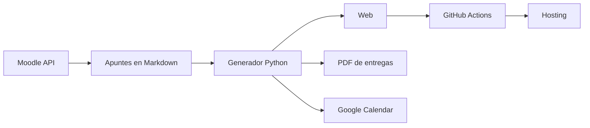

# Proyectos con ayuda de IA

Proyectos propios hechos con un asistente de IA para programar (Claude Code). Yo decido qué se hace, fijo las normas y reviso y pruebo cada cambio. La IA escribe buena parte del código.

## 1. Web de apuntes de ASIR

**[daniroca5.gamer.gd](https://daniroca5.gamer.gd/)**. Escribo los apuntes en Markdown y un generador en Python los convierte en una web que se publica sola.

 

### Cómo se usa
- **Crear una página**: escribo un `.md` con el nombre de su asignatura, tema y tipo (por ejemplo `SRI[1](2)__DNS__[T].md`). Al publicar, sale como página nueva en el menú de esa asignatura.
- **Publicar**: un solo comando hace todo el ciclo:
  1. baja los últimos cambios;
  2. genera la web y valida que no haya enlaces rotos ni errores;
  3. hace el commit y lo sube a GitHub;
  4. una GitHub Action la despliega por FTP.
- **Notas especiales en el texto**: `[(fechas)]`, `[(tarea)]`, `[(material)]`… Con ellas la web rellena sola el inicio: fechas de exámenes y entregas, tareas pendientes y notas.

### Qué tiene
- **Inicio**: la clase en curso y la siguiente, el horario, las fechas (en lista o calendario) y un **tablero de tareas** sacado de las casillas de los apuntes.
- **Índice lateral (TOC)** en cada documento. Va fijo al hacer scroll, tiene los niveles H1-H4 y botones para ir a la última sesión o a un marcador.
- **Página de comandos**: una biblioteca con todos los comandos que salen en los apuntes, por programa y sistema. Cada bloque de código enlaza a ella.
- **Buscador** (Ctrl+K) y atajos de teclado.
- **Código**:
  - resaltado de sintaxis;
  - botón de copiar;
  - definiciones de las siglas al pasar el ratón.
- **Tests interactivos** para repasar.
- **Visor de capturas** con zoom.
- **5 temas de color** y un modo de accesibilidad.
- **Sincronización** de lo que marco (tareas hechas, marcadores) entre el móvil y los PC, con una pequeña API en PHP.

### Integraciones
- **Moodle (API de servicios web)**: un script se conecta al aula virtual del centro con un token y hace tres cosas:
  - ve si hay material nuevo y lo descarga a la carpeta de cada asignatura;
  - lee las fechas de entrega;
  - registra el material en la web, en la pestaña *Material*.
- **Google Calendar**: los exámenes y entregas pasan al calendario con avisos en el móvil.
- **PDF**: las prácticas se entregan en PDF generado desde el mismo Markdown, con índice y metadatos.

## 2. La tele con IA
Control de la Android TV de casa desde el PC por ADB: saber por qué capítulo voy de una serie y dejar listo el siguiente.

## 3. Ordenar el PC
Indexar los discos, renombrar con una convención fija, detectar duplicados verificados por contenido y generar informes en HTML.

## 4. Scripts de descarga y catalogación
Scripts que recopilan el contenido que tengo guardado en distintas plataformas y lo organizan en local por categorías.

## 5. Otros
- **Mensajería entre mis PC**: una pequeña aplicación en C# que manda avisos por una red privada (Tailscale).

---
Daniel Roca Martínez · [Currículum](https://daniroca5.gamer.gd/cv/)
